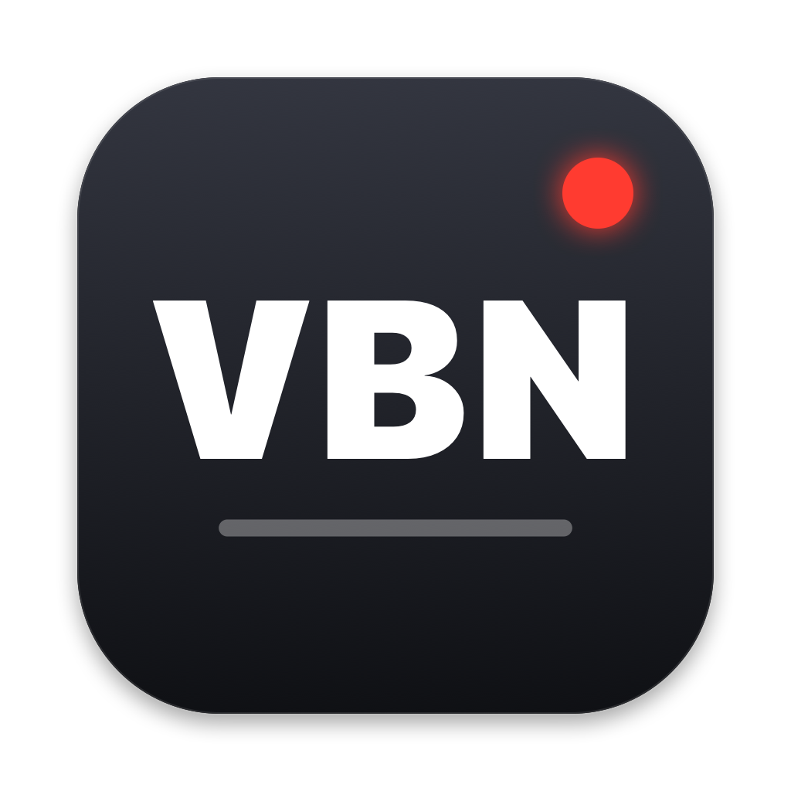

<p align="center"></p>

# unVBN: Vizrt `.vbn` images on macOS

A small macOS app that makes Vizrt Viz Artist / Viz Engine `.vbn` image files viewable on a Mac:

- **Quick Look preview** (space bar in Finder)
- **Finder thumbnails**
- **Double-click → opens as a PNG in Preview (Aperçu)**, plus *File > Export PNG…* for the last file opened

Single images only. Sequences (`NAME_00000.vbn` … `NAME_00749.vbn`) are opened frame by frame; there is no playback yet.
The format itself is documented in [`FORMAT.md`](FORMAT.md). The Python reference decoder is in `reference/`.

## Install

```sh
scripts/install.sh          # builds Release, copies unVBN.app to ~/Applications, registers it
```

To do it by hand, copy `unVBN.app` to `~/Applications/`, launch it once, then run `qlmanage -r`. Launching
the app registers the `.vbn` type and the two Quick Look extensions (`pluginkit -m -v | grep -i vbn`
should list `com.notjeremie.unvbn.preview` and `com.notjeremie.unvbn.thumbnail`).

## How it works

Apple has no public ImageIO plug-in API, so no app can teach Preview itself to read a new image format.
unVBN works around this in two ways:

- **Quick Look**: two app extensions. `unVBNPreview` is a data-based preview (`QLPreviewProvider`) that
  returns a PNG. `unVBNThumbnail` (`QLThumbnailProvider`) draws the image aspect-fit.
- **Double-click**: the app is registered as the *Viewer* for `com.vizrt.vbn`. It decodes the file,
  writes `$TMPDIR/unVBN/<name>.png` and opens that file in Preview (`com.apple.Preview`). When the app
  is launched only to open files, it shows no window. When it is launched on its own, a small window
  with *Open .vbn…* and *Export PNG…* appears.

The type `com.vizrt.vbn` (extension `vbn`, conforms to `public.image` and `public.data`) is declared as
an **imported** type in `App/Info.plist`. The format belongs to Vizrt, not to this app, and an imported
declaration gives way to Vizrt's own if one is ever installed.

### Targets

| Target | What |
|---|---|
| `VBNCore` | Static framework: `VBNImage.decode(data:) -> CGImage` (upright, non-premultiplied alpha), `VBNImage.decodeRGBA`, `pngData`, `QuickLZ` (1.5 level 3), `BC3` (DXT5). Linked statically into each target, so there is no embedded framework to sign. |
| `unVBN` | Host app (AppKit plus a small SwiftUI view), `App/`. |
| `unVBNPreview` | Quick Look preview extension, `Preview/`. Sandboxed, as Quick Look requires. |
| `unVBNThumbnail` | Quick Look thumbnail extension, `Thumbnail/`. Sandboxed. |
| `VBNCoreTests` | Unit tests, `Tests/VBNCoreTests/`. |

Deployment target: macOS 14. This is the oldest version still getting security updates. The APIs used
need macOS 12 or later (`QLPreviewReply`, data-based previews).

## Build and test

`project.yml` is the source of truth. `unVBN.xcodeproj` is generated with [XcodeGen](https://github.com/yonaskolb/XcodeGen)
and committed, so the project opens without XcodeGen. After editing `project.yml`, run `xcodegen generate` and commit both.

```sh
xcodegen generate
xcodebuild -project unVBN.xcodeproj -scheme unVBN -destination 'platform=macOS' -derivedDataPath build/DerivedData test
xcodebuild -project unVBN.xcodeproj -scheme unVBN -configuration Release -derivedDataPath build/DerivedData build
```

The tests build small synthetic files in code: raw BGRA 4×4, DXT5 8×4 with known blocks, and QuickLZ
streams (all-literal, stored, 1-byte and 2-byte back-references). They also check the error cases.
`RealSampleTests` decodes real `.vbn` files and compares each one pixel for pixel against the `X.png`
the Python reference wrote next to `X.vbn`. It reads `samples/` at the repo root (git-ignored) by default;
point it elsewhere with `TEST_RUNNER_VBN_SAMPLES_DIR=/path xcodebuild … test`. The test is skipped when the folder does not exist.
**Real Viz files belong to whoever made them: never commit them** (`*.vbn` and `samples/` are git-ignored).

To check by hand:

```sh
qlmanage -t -x -s 256 -o /tmp/thumbs file.vbn   # thumbnail through quicklookd (-x), as Finder does
qlmanage -p file.vbn                            # preview window
open file.vbn                                   # PNG opens in Preview
```

Without `-x`, `qlmanage -t` computes thumbnails in-process, and on this Mac that hung for app-extension
thumbnailers. Finder always goes through the server, so use `-x`.

## Install from a release

Download `unVBN-<version>.dmg` from [Releases](https://github.com/notjeremie/unVBN/releases), drag
**unVBN** to Applications, launch it once (this registers the `.vbn` type and the Quick Look extensions),
then quit it. Space bar and thumbnails work in Finder from then on. Releases are signed with a Developer ID
and notarized by Apple.

## Signing and distribution

`project.yml` uses **ad-hoc signing** (`CODE_SIGN_IDENTITY = -`, no team), so anyone can build and run
locally. `scripts/release.sh` builds the distributable dmg: it passes the Developer ID settings on the
command line (team, hardened runtime, secure timestamp, no `get-task-allow`), verifies the signature,
packages and signs the dmg, then notarizes and staples it.

```sh
xcrun notarytool store-credentials <profile> --apple-id <apple-id> --team-id <TEAM_ID>   # once
TEAM_ID=<TEAM_ID> NOTARY_PROFILE=<profile> scripts/release.sh                            # -> build/release/
```

It builds in `$TMPDIR`, not in the repo: iCloud Drive tags files under `~/Documents` with
`com.apple.FinderInfo`, which `codesign --strict` and notarization reject.

The app icon is drawn in code: `scripts/make-icon.sh` runs `scripts/make-icon.swift` and rebuilds
`App/Assets.xcassets/AppIcon.appiconset` and `docs/icon.png`.

## License

[MIT](LICENSE). Vizrt and Viz Artist / Viz Engine are trademarks of Vizrt; this project is not affiliated
with Vizrt. The format was documented by reading files, for interoperability.
